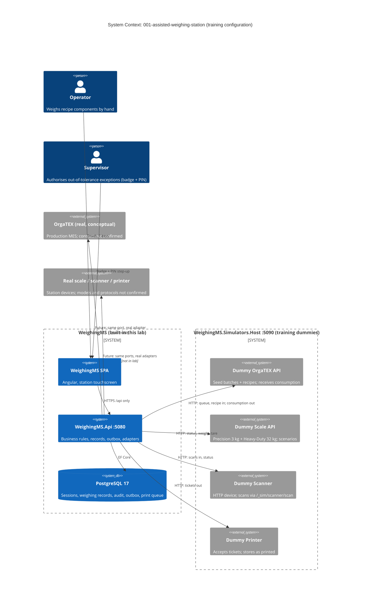

# Assisted Weighing Station: System Context

## System Overview

WeighingMS is the **weighing-station application**. It guides an operator through manual weighing of a dyeing recipe, checks every reading against tolerance, records who weighed what, posts the actual consumption back to OrgaTEX and prints a ticket. **OrgaTEX stays the production system**: it owns batches and recipes. WeighingMS doesn't replace it (Intent, CP1). WeighingMS doesn't dispense; operators dispense by hand (PDF scope).

The real OrgaTEX, scales, scanner and printer **aren't available** in this lab. Each is replaced by a **training dummy** in a separate process, `WeighingMS.Simulators.Host`. WeighingMS reaches every external party through a **port** (an interface in the Application layer). Today the port is bound to a dummy adapter; later it will be bound to a real one. This is configuration and adapter work only, with no change to business rules (PDF "replaceable mocks"; system-architecture).

> **Two layers in this document**
> - **Conceptual (real)**: what WeighingMS talks to in production. It has no confirmed contract; FCI hasn't confirmed any interface (brief §9, A-01…A-15).
> - **Training (dummy)**: what WeighingMS actually talks to in this lab. These are **training contracts, not claims about the real OrgaTEX or devices** (FR-25…FR-28, tag [T]).

## Actors

| Actor | Type | Uses WeighingMS to | Authenticates by | Requirements |
|---|---|---|---|---|
| **Operator** | Human | Select a batch, identify the component, capture lot and container, tare, dispense, confirm, quit, complete, print | Badge sign-in → session (ADR-009) | FR-1…FR-14, FR-17…FR-21 |
| **Supervisor** | Human | Authorise an exception for an out-of-tolerance weighing (override) with a mandatory reason; reprint | Supervisor badge + **PIN step-up** per action (ADR-009) | FR-15, FR-21 |

## Systems and devices: real vs training dummy

| Real conceptual party | Kind | Its role towards WeighingMS | Training dummy (this lab) | Where the dummy runs | Port in WeighingMS |
|---|---|---|---|---|---|
| **OrgaTEX** (MES) | External system | Source of the batch queue and recipes; receiver of actual consumption | **Dummy OrgaTEX API**: seed B-24187 / SO-9931 / JET-04 / Teal 4C + B-24188, B-24190, B-24191 | Simulators.Host :5090 | `IOrgatexGateway` |
| **Scale**: Precision ≤ 3 kg, Heavy-Duty > 3 kg (mockup names: 3 kg precision, 32 kg floor) | Device | Live weight, stability, tare, status | **Dummy Scale API**: 2 scales, scenarios rising / below range / enter range / overshoot / stable, resolution per scale | Simulators.Host :5090 | `IScaleDevice` |
| **Scanner** (barcode) | Device | Reads batch cards and lot labels | **Dummy Scanner**: device-style HTTP; a scan is emitted with `POST /_sim/scanner/scan` | Simulators.Host :5090 | `IScanner` |
| **Ticket printer** | Device | Prints the 80 mm weighing ticket | **Dummy Printer**: accepts `POST /api/tickets`, stores tickets as printed | Simulators.Host :5090 | `IPrinter` |
| **WeighingMS** | The system being built | — | *(not a dummy)*: Angular SPA + WeighingMS.Api :5080 + PostgreSQL 17 | Station | — |

## Context Diagram



```text
 Operator ─┐                       ┌──────────────── TRAINING (this lab) ─────────────────┐
 Supervisor┤ touch / badge + PIN   │ WeighingMS.Simulators.Host :5090                     │
           ▼                       │  Dummy OrgaTEX API · Dummy Scale API (×2)            │
 ┌─ WeighingMS ───────────────┐    │  Dummy Scanner · Dummy Printer · /_sim/* control     │
 │ SPA ──/api──► Api :5080 ───┼─B1─┼─► adapters bound to the dummies                      │
 │                │ ports:    │    └──────────────────────────────────────────────────────┘
 │                │ IOrgatexGateway · IScaleDevice · IScanner · IPrinter
 │                ▼           │    ┌──────────────── REAL (conceptual, later) ────────────┐
 │           PostgreSQL 17    │─B1─┼─► OrgaTEX MES · real scales · scanner · printer      │
 └────────────────────────────┘    │   (same ports, new adapters; contracts unconfirmed)  │
                                   └──────────────────────────────────────────────────────┘
```

## Data flows

### Inbound (into WeighingMS)

| # | From (real → dummy) | Data | Lab contract (dummy) | Validation in WeighingMS | Req |
|---|---|---|---|---|---|
| I1 | OrgaTEX → Dummy OrgaTEX | Batch queue: batch, order, machine, fabric, shade, component count, status | `GET /api/batches`, `GET /api/batches/:batchId` | Schema; unknown batch → error, never invented data | FR-1, FR-2, FR-25 |
| I2 | OrgaTEX → Dummy OrgaTEX | Recipe: ordered components, chemical id/name, target, unit, optional tolerance | `GET /api/batches/:batchId/recipe` | Target > 0; unit known; tolerance from recipe, else config, else **blocked** | FR-3, FR-12 |
| I3 | Scale → Dummy Scale | Live reading: value, unit, stable flag, timestamp | `GET /api/scales/:scaleId/weight`, polled ~250 ms (ADR-004) | Invalid readings never enable Confirm; fixed-point decimals | FR-9, FR-13, FR-23 |
| I4 | Scale → Dummy Scale | Scale list, capacity, resolution, status READY / OFFLINE | `GET /api/scales`, `GET /api/scales/:scaleId/status` | Scale chosen by the configurable ≤ 3 kg threshold | FR-8, FR-23 |
| I5 | Scale → Dummy Scale | Tare result | `POST /api/scales/:scaleId/tare` (response) | Tare required before Confirm; re-tare after reconnect | FR-7 |
| I6 | Scanner → Dummy Scanner | Scan code (batch ID on the queue view, lot on the weigh view); scanner status | Emitted by `POST /_sim/scanner/scan`; the Api's `IScanner` adapter collects it from the simulator, and the SPA receives it from the Api (detail fixed in the scanner bolt) | Unknown batch → message; lot is captured, not identity-verified | FR-2, FR-5, FR-27 |
| I7 | Operator / Supervisor | Badge, PIN, lot (typed), container ID, override reason, commands | SPA → Api | PIN hashed, rate-limited; reason mandatory | FR-5, FR-6, FR-15 |
| I8 | Configuration | Threshold, scale assignment, tolerance per chemical + scale, plant time zone, poll interval, retry policy | `appsettings` / `IOptionsMonitor` | Validated on start | FR-8, FR-12, FR-22 |

### Outbound (out of WeighingMS)

| # | To (real → dummy) | Data | Lab contract (dummy) | Guarantee | Req |
|---|---|---|---|---|---|
| O1 | OrgaTEX → Dummy OrgaTEX | Actual consumption per component for a completed batch | `POST /api/batches/:batchId/consumption` + `Idempotency-Key` | **Store-and-forward outbox**: saved in the completion transaction; bounded automatic retry; then "sync failed" for manual retry; never posted twice | FR-20, PD-01 |
| O2 | Scale → Dummy Scale | Tare command | `POST /api/scales/:scaleId/tare` | Only when the scale is READY | FR-7 |
| O3 | Printer → Dummy Printer | Ticket: batch, order, machine, shade, date (plant zone), operator, components target/actual, OVR marks, Code 128 batch ID | `POST /api/tickets` + `Idempotency-Key` | Completion isn't blocked; "print pending" + manual print; later prints are marked REPRINT | FR-21, PD-02, PD-04 |
| O4 | Operator / Supervisor (SPA) | Queue, recipe rail, live weight + server-side class, remaining, status strip, summary, ticket preview | Api → SPA | Classification computed on the server only | FR-9…FR-18 |
| O5 | Reviewers | Completed-batch summary and weighing records | Api → SPA | Records are immutable; overrides are flagged | FR-18, FR-19 |

## Ownership

| Data / capability | Owner (system of record) | WeighingMS holds | Notes |
|---|---|---|---|
| Batches, orders, recipes, target quantities | **OrgaTEX** | Read-only snapshot taken when the batch is loaded | Never edited in WeighingMS |
| Weighing sessions, weighing records (actual, class, operator, lot, container, tare, scale, UTC time), overrides, audit trail | **WeighingMS** (PostgreSQL) | Source of truth | Job → recipe → chemical → record preserved (PDF) |
| Consumption after write-back | OrgaTEX (once accepted) | Outbox entry + sync state | WeighingMS stays the record of what was weighed |
| Tolerance fallback, scale threshold and assignment, time zone | **WeighingMS configuration** | Config | Recipe tolerance wins when present |
| Live weight, stability, tare | **Scale** device | Only the reading that was confirmed | Not stored while streaming |
| Printed ticket (paper) | Printer / physical record | Ticket data + print status | BR-15 risk accepted (PD-02) |
| Operator and supervisor identities, roles, PIN hashes | **WeighingMS** (lab seed) | Source of truth in the lab | Real identity source is not confirmed |
| **Training data and contracts**: seed batches, scenarios, faults, received consumption, printed tickets | **Simulators.Host** | — | Product code, tested like product code; **not** a claim about the real systems |

## Integration boundaries

| Boundary | Between | Mechanism | Rule |
|---|---|---|---|
| **B0** UI boundary | SPA ↔ WeighingMS.Api | Same-origin HTTPS `/api/*`, cookie session + XSRF | The UI calls **only** the Api; no scenario data in components (CLAUDE.md) |
| **B1** Integration boundary | Api (Application ports) ↔ external parties | Ports `IOrgatexGateway`, `IScaleDevice`, `IScanner`, `IPrinter`; typed HttpClient adapters in Infrastructure with resilience (timeout, retry with jitter for idempotent calls, circuit breaker) | Business rules never see HTTP or a dummy; swapping dummy → real changes adapters and config only |
| **B2** Training boundary | Dummies ↔ test / demo control | `/_sim/*` (reset, faults, scale scenarios, scanner scan, inspect consumption / tickets), Development / Test only | Never called by the SPA in production flows; not part of the real contracts |
| **B3** Persistence boundary | Api ↔ PostgreSQL | EF Core | Only the Api writes; records and audit are append-only |

## Failure boundaries

Each failure stops at its own boundary. No failure turns a failed weighing into a successful record (PDF §6 Step 7).

| Failure (where it's injected in the lab) | Detected at | Contained by | What the operator sees | What is never allowed | Req |
|---|---|---|---|---|---|
| Scale offline / timeout (`/_sim/faults` `scale:{id}`) | B1, `IScaleDevice` | Adapter → `ScaleUnavailable` | "Scale offline", weight "—"; Confirm and Tare disabled; re-tare on return | A record written from a stale or missing reading | FR-23 |
| Invalid or unstable reading (scale scenario) | Domain rule | Classification + stable guard | Confirm stays disabled; "Over capacity" when above capacity | Confirm on an invalid or unstable reading | FR-13, FR-23 |
| Out-of-tolerance reading (scenario belowRange / overshoot) | Domain rule | Tolerance band, inclusive bounds | Underweight / Overweight state; override path | Success without a supervisor PIN + reason; overshoot handling beyond warn / block is **PD-05 (STEP 24)** | FR-12, FR-15, FR-16 |
| OrgaTEX down while loading (`orgatex`) | B1, `IOrgatexGateway` | Error + Retry | Queue / recipe error with Retry | Invented or cached batch data | FR-24 |
| OrgaTEX down at completion | Outbox worker | Outbox, bounded retry | Batch completes; "write-back pending", then "sync failed" + manual retry | Losing or duplicating the consumption | FR-20, FR-24 |
| Scanner offline (`scanner`) | B1, `IScanner` | Status only | SCANNER OFFLINE; touch selection and typed lot still work | Blocking the workflow | FR-24, FR-27 |
| Printer offline (`printer`) | B1, `IPrinter` | Print queue | Batch completes; "print pending"; Print (F1) later | Rolling back completion; a duplicate print without REPRINT | FR-21, FR-24 |
| Database unavailable | B3 | Global error handler (500 ProblemDetails) | Error state; nothing confirmed | Confirming without persisting | NFR Reliability |
| Simulator host down entirely | B1 (all adapters) | Each adapter independently | Every device / OrgaTEX shows offline | Fake readings from the SPA | FR-23, FR-24 |

## External Integrations (summary)

- **OrgaTEX**: batch queue and recipe in, actual consumption out. Lab: Dummy OrgaTEX API (`/api/batches…`). Real contract: not confirmed (brief §9.2 Q6–Q13).
- **Scale ×2**: live weight, stability, tare, status. Lab: Dummy Scale API (`/api/scales…`). Real model and protocol: not confirmed (Q15, Q16).
- **Scanner**: batch and lot codes. Lab: Dummy Scanner (`/_sim/scanner/scan`). No keyboard wedge (PD-03).
- **Printer**: 80 mm ticket. Lab: Dummy Printer (`POST /api/tickets`). Real printer language: not confirmed (Q18).

## High-Level Constraints

- The UI calls only WeighingMS.Api; the dummies are reached only through ports and adapters (B0, B1).
- No real OrgaTEX contract is invented. The lab endpoints are the workbook STEP 16 training contracts.
- The dummies are first-class product code in a separate process (ADR-003), so they can be tested, faulted and replaced.
- Stack: .NET 10 Clean modular monolith, Angular, PostgreSQL 17 (tech-stack, data-stack).

## Key NFR Goals

- **Correctness**: fixed-point decimals and inclusive bounds; the server is the only place that classifies readings.
- **Reliability**: no lost or duplicate write-back (outbox + idempotency); each failure contained at its boundary.
- **Traceability**: every record holds operator, lot, container, tare, scale and UTC time; overrides are flagged and audited.
- **Replaceability**: swapping dummy → real is an adapter and config change, verified by architecture tests.
- **Responsiveness**: live weight is polled at ~250 ms (configurable).

## Open items carried forward

- **PD-05**: overshoot handling beyond warn / block / override is decided at STEP 24.
- **Scanner delivery detail** (I6): how the Api collects a scan from the dummy and hands it to the SPA is fixed in the scanner bolt, within the PD-03 decision (device API, no wedge).
- **Real contracts** for OrgaTEX, the scales, the scanner and the printer are outside the lab (A-01…A-15 unconfirmed).
